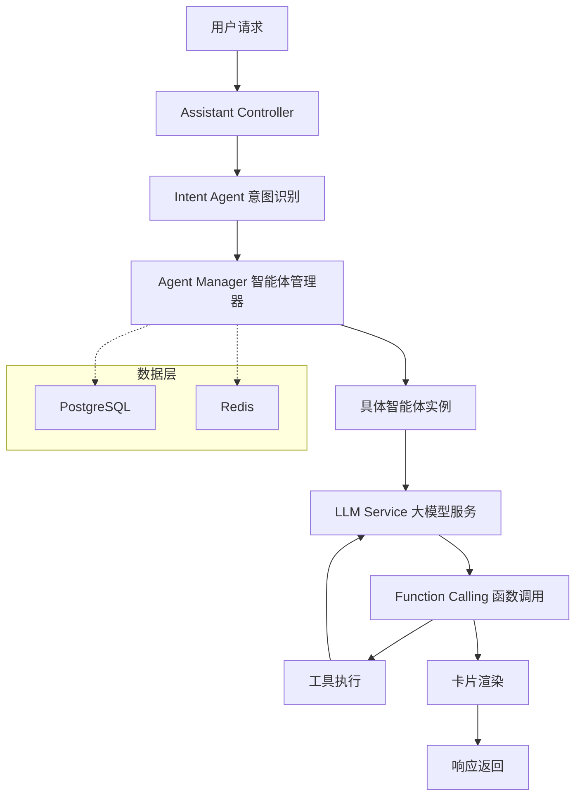

# Multi-Agent Architecture Platform

[](https://www.oracle.com/java/)
[](https://spring.io/projects/spring-boot)
[](https://spring.io/projects/spring-ai)
[](https://opensource.org/licenses/Apache-2.0)
[](https://www.docker.com/)

## 🌍 语言选择 | Language Select

**简体中文** | [English](README_EN.md) | [日本語](README_JA.md) | [한국어](README_KO.md) | [Русский](README_RU.md) | [Español](README_ES.md)

---

> 🚀 一个基于Spring AI和WebFlux的企业级多智能体架构平台，支持Function Calling、ReAct等先进范式，为构建智能对话系统提供强大而灵活的基础设施。

## ✨ 核心特性

- 🤖 **多智能体协作架构** - 支持多种类型智能体的统一管理和调度
- 🔄 **Function Calling支持** - 完整的工具调用能力，支持自定义函数扩展
- ⚡ **ReAct范式实现** - 推理-行动循环，让智能体能够进行复杂的多步推理
- 🌊 **响应式编程** - 基于WebFlux的非阻塞异步架构
- 💾 **多数据源支持** - PostgreSQL + Redis的双重数据存储策略
- 🐳 **容器化部署** - 完整的Docker支持，一键部署
- 🔧 **高度可配置** - 灵活的配置管理，支持多种LLM提供商
- 🎯 **企业级特性** - 用户隔离、权限管理、会话持久化

## 🏗️ 架构概览



## 🚀 快速开始

### 环境要求

- **Java**: 17+
- **Maven**: 3.6+
- **PostgreSQL**: 12+
- **Redis**: 6+

### 本地开发环境搭建

1. **克隆项目**
   ```bash
   git clone https://github.com/your-username/multi-agent-arch.git
   cd multi-agent-arch
   ```

2. **配置数据库**

   创建PostgreSQL数据库：
   ```sql
   CREATE DATABASE assistant;
   ```

   创建用户表（如果需要）：
   ```sql
   -- 项目会自动通过JPA DDL创建表结构
   -- ddl-auto: update 模式会自动更新表结构
   ```

3. **配置环境变量**

   复制并编辑配置文件：
   ```bash
   # 在 application.yaml 中配置或通过环境变量设置

   # 数据库配置
   export SPRING_DATASOURCE_URL=jdbc:postgresql://localhost:5432/assistant
   export SPRING_DATASOURCE_USERNAME=your_username
   export SPRING_DATASOURCE_PASSWORD=your_password

   # Redis配置
   export SPRING_REDIS_HOST=localhost
   export SPRING_REDIS_PORT=6379
   export SPRING_REDIS_PASSWORD=your_redis_password

   # LLM配置 (支持OpenAI兼容接口)
   export LLM_MODEL_SERIES=qwen
   export LLM_API_KEY=your_api_key
   export LLM_ADDRESS=https://dashscope.aliyuncs.com/compatible-mode/v1
   export LLM_MODEL=qwen-plus
   ```

4. **运行应用**
   ```bash
   mvn spring-boot:run
   ```

   或构建后运行：
   ```bash
   mvn clean package
   java -jar target/mss-ai.jar
   ```

5. **验证服务**

   服务启动后，访问健康检查端点：
   ```bash
   curl http://localhost:8080/ai/actuator/health
   ```

### Docker 部署

1. **构建镜像**
   ```bash
   mvn clean package
   docker build -t multi-agent-arch .
   ```

2. **运行容器**
   ```bash
   docker run -d \
     --name multi-agent-arch \
     -p 8080:8080 \
     -e SPRING_DATASOURCE_URL=jdbc:postgresql://host.docker.internal:5432/assistant \
     -e SPRING_DATASOURCE_USERNAME=your_username \
     -e SPRING_DATASOURCE_PASSWORD=your_password \
     -e LLM_API_KEY=your_api_key \
     multi-agent-arch
   ```

## 📚 API 文档

### 聊天对话接口

**POST** `/ai/chat/completions`

发起与智能体的对话，支持流式响应。

```bash
curl -X POST http://localhost:8080/ai/chat/completions \
  -H "Content-Type: application/json" \
  -d '{
    "content": "帮我查询今天的天气",
    "extra": {
      "location": "北京",
      "language": "zh-CN"
    }
  }'
```

**请求参数:**
- `content` (string, 必需): 用户输入的消息内容
- `extra` (object, 可选): 额外的上下文信息

**响应格式:**
```json
{
  "content": "好的，我来帮您查询北京的天气信息...",
  "status": "REPLYING",
  "data": {},
  "design": {}
}
```

### 意图识别

系统能够自动识别用户意图并调度相应的智能体：

- **通用对话智能体** - 处理日常对话交流
- **工具调用智能体** - 执行具体的函数调用
- **知识检索智能体** - 进行信息查询和分析

### Function Calling 支持

系统支持完整的函数调用生命周期：

1. **函数注册** - 在Agent配置中定义可用的工具函数
2. **调用解析** - LLM自动识别需要调用的函数
3. **参数提取** - 从对话中提取函数调用参数
4. **函数执行** - 调用实际的业务逻辑
5. **结果处理** - 将执行结果反馈给LLM进行下一步处理

## 🛠️ 核心组件

### Agent Manager (智能体管理器)

负责智能体的生命周期管理：
- 智能体类型的加载和管理
- 智能体实例的创建和销毁
- 会话状态的超时管理 (15分钟自动过期)

### Intent Agent (意图识别智能体)

基于LLM的意图识别系统：
- 分析用户输入的业务类型
- 自动调度到相应的专业智能体
- 支持动态意图配置

### LLM Service (大模型服务)

统一的LLM调用接口：
- 支持多种LLM提供商 (当前实现通义千问)
- 流式和非流式响应模式
- 完整的Function Calling支持

### Function Call Service (函数调用服务)

可扩展的函数调用框架：
- 支持本地和远程函数调用
- 统一的调用接口和响应格式
- 支持卡片式响应渲染

## 🔧 配置说明

### application.yaml 完整配置示例

```yaml
# 服务基础配置
spring:
  webflux:
    base-path: /ai
  data:
    redis:
      host: ${SPRING_REDIS_HOST:localhost}
      port: ${SPRING_REDIS_PORT:6379}
      password: ${SPRING_REDIS_PASSWORD}
  datasource:
    url: ${SPRING_DATASOURCE_URL:jdbc:postgresql://localhost:5432/assistant}
    username: ${SPRING_DATASOURCE_USERNAME}
    password: ${SPRING_DATASOURCE_PASSWORD}
    driver-class-name: org.postgresql.Driver
  jpa:
    hibernate:
      ddl-auto: update
    show-sql: true
    properties:
      hibernate:
        dialect: org.hibernate.dialect.PostgreSQLDialect

# 业务相关配置
business:
  llm:
    model-series: ${LLM_MODEL_SERIES:qwen}
    api-key: ${LLM_API_KEY}
    url: ${LLM_ADDRESS}
    model: ${LLM_MODEL}

# 日志配置
logging:
  level:
    root: ${LOGGING_LEVEL:info}
    site.nullpointer.mss.ai: DEBUG
```

### 智能体类型配置

智能体类型存储在数据库中，包含以下配置：

- `type`: 智能体类型标识
- `system_prompt`: 系统提示词
- `function_tools`: 可用函数工具JSON配置
- `temperature`: 温度参数
- `description`: 智能体描述

## 🎯 使用示例

### 1. 基础对话

```bash
curl -X POST http://localhost:8080/ai/chat/completions \
  -H "Content-Type: application/json" \
  -d '{
    "content": "你好，请介绍一下你自己"
  }'
```

### 2. Function Calling 示例

```bash
curl -X POST http://localhost:8080/ai/chat/completions \
  -H "Content-Type: application/json" \
  -d '{
    "content": "帮我创建一个待办事项：完成项目文档",
    "extra": {
      "priority": "high",
      "category": "work"
    }
  }'
```

### 3. ReAct 范式示例

```bash
curl -X POST http://localhost:8080/ai/chat/completions \
  -H "Content-Type: application/json" \
  -d '{
    "content": "我需要分析一下用户的购买行为数据，你能帮我吗？"
  }'
```

系统会自动执行以下步骤：
1. 分析用户需求
2. 调用数据分析工具
3. 解析分析结果
4. 提供洞察和建议

## 🧪 开发指南

### 添加新的智能体类型

1. 在数据库中插入新的智能体类型：
```sql
INSERT INTO agent_type (type, system_prompt, function_tools, temperature, description, is_public, enterprise_id)
VALUES (
  'CUSTOM_AGENT',
  '你是一个专业的数据分析助手...',
  '[{"function": {"name": "analyze_data", "description": "分析数据"}}]',
  0.7,
  '数据分析智能体',
  true,
  'default'
);
```

2. 重启应用或调用AgentManager的`loadAgentType()`方法重新加载配置。

### 自定义Function Calling

1. 实现`FunctionCallService`接口：
```java
@Service
public class CustomFunctionCallService implements FunctionCallService {
    @Override
    public FunctionCallResult apply(FunctionCallRequest request) {
        // 实现你的业务逻辑
        return FunctionCallResult.builder()
            .content("执行结果")
            .build();
    }
}
```

2. 在智能体配置中注册你的函数：
```json
{
  "function": {
    "name": "custom_function",
    "description": "自定义函数描述",
    "parameters": {
      "type": "object",
      "properties": {
        "param1": {"type": "string"}
      }
    }
  }
}
```

## 🤝 贡献指南

我们欢迎所有形式的贡献！请阅读以下指南：

1. Fork 本仓库
2. 创建你的特性分支 (`git checkout -b feature/AmazingFeature`)
3. 提交你的更改 (`git commit -m 'Add some AmazingFeature'`)
4. 推送到分支 (`git push origin feature/AmazingFeature`)
5. 开启一个 Pull Request

### 代码规范

- 遵循 Spring Boot 最佳实践
- 使用 Lombok 减少样板代码
- 保持代码简洁和可读性
- 添加适当的单元测试

## 📄 许可证

本项目采用 Apache License 2.0 许可证。详情请查看 [LICENSE](LICENSE) 文件。

## 🙏 致谢

- [Spring AI](https://spring.io/projects/spring-ai) - 提供强大的AI集成框架
- [Spring WebFlux](https://spring.io/projects/spring-boot) - 响应式Web框架
- [通义千问](https://qianwen.aliyun.com/) - 提供优秀的LLM能力

## 📞 联系我们

- 项目主页: [https://github.com/your-username/multi-agent-arch](https://github.com/your-username/multi-agent-arch)
- 问题反馈: [Issues](https://github.com/your-username/multi-agent-arch/issues)
- 讨论交流: [Discussions](https://github.com/your-username/multi-agent-arch/discussions)

---

<div align="center">
  <p>如果这个项目对你有帮助，请给我们一个 ⭐️</p>
  <p>Made with ❤️ by the Multi-Agent Architecture Team</p>
</div>