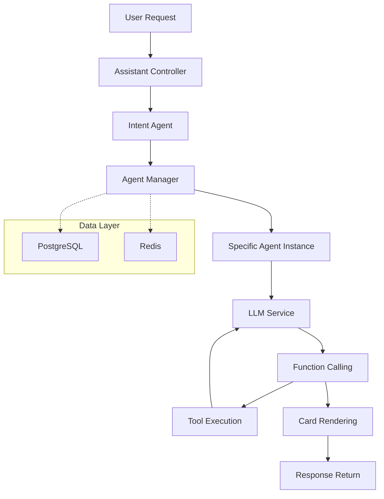

# Multi-Agent Architecture Platform

[](https://www.oracle.com/java/)
[](https://spring.io/projects/spring-boot)
[](https://spring.io/projects/spring-ai)
[](https://opensource.org/licenses/Apache-2.0)
[](https://www.docker.com/)

## 🌍 Language Select | 语言选择

**English** | [简体中文](README.md) | [日本語](README_JA.md) | [한국어](README_KO.md) | [Русский](README_RU.md) | [Español](README_ES.md)

---

> 🚀 An enterprise-grade multi-agent architecture platform based on Spring AI and WebFlux, supporting advanced paradigms like Function Calling and ReAct, providing powerful and flexible infrastructure for building intelligent conversational systems.

## ✨ Core Features

- 🤖 **Multi-Agent Collaboration Architecture** - Unified management and scheduling of various types of intelligent agents
- 🔄 **Function Calling Support** - Complete tool calling capabilities with custom function extensions
- ⚡ **ReAct Paradigm Implementation** - Reasoning-Action cycles enabling complex multi-step reasoning
- 🌊 **Reactive Programming** - Non-blocking asynchronous architecture based on WebFlux
- 💾 **Multi-Data Source Support** - Dual data storage strategy with PostgreSQL + Redis
- 🐳 **Containerized Deployment** - Complete Docker support with one-click deployment
- 🔧 **Highly Configurable** - Flexible configuration management supporting multiple LLM providers
- 🎯 **Enterprise Features** - User isolation, permission management, session persistence

## 🏗️ Architecture Overview



## 🚀 Quick Start

### Requirements

- **Java**: 17+
- **Maven**: 3.6+
- **PostgreSQL**: 12+
- **Redis**: 6+

### Local Development Setup

1. **Clone Project**
   ```bash
   git clone https://github.com/your-username/multi-agent-arch.git
   cd multi-agent-arch
   ```

2. **Configure Database**

   Create PostgreSQL database:
   ```sql
   CREATE DATABASE assistant;
   ```

3. **Configure Environment Variables**

   Copy and edit configuration file:
   ```bash
   # Database configuration
   export SPRING_DATASOURCE_URL=jdbc:postgresql://localhost:5432/assistant
   export SPRING_DATASOURCE_USERNAME=your_username
   export SPRING_DATASOURCE_PASSWORD=your_password

   # Redis configuration
   export SPRING_REDIS_HOST=localhost
   export SPRING_REDIS_PORT=6379
   export SPRING_REDIS_PASSWORD=your_redis_password

   # LLM configuration (OpenAI compatible API)
   export LLM_MODEL_SERIES=qwen
   export LLM_API_KEY=your_api_key
   export LLM_ADDRESS=https://dashscope.aliyuncs.com/compatible-mode/v1
   export LLM_MODEL=qwen-plus
   ```

4. **Run Application**
   ```bash
   mvn spring-boot:run
   ```

   Or build and run:
   ```bash
   mvn clean package
   java -jar target/mss-ai.jar
   ```

5. **Verify Service**

   After service startup, visit health check endpoint:
   ```bash
   curl http://localhost:8080/ai/actuator/health
   ```

### Docker Deployment

1. **Build Image**
   ```bash
   mvn clean package
   docker build -t multi-agent-arch .
   ```

2. **Run Container**
   ```bash
   docker run -d \
     --name multi-agent-arch \
     -p 8080:8080 \
     -e SPRING_DATASOURCE_URL=jdbc:postgresql://host.docker.internal:5432/assistant \
     -e SPRING_DATASOURCE_USERNAME=your_username \
     -e SPRING_DATASOURCE_PASSWORD=your_password \
     -e LLM_API_KEY=your_api_key \
     multi-agent-arch
   ```

## 📚 API Documentation

### Chat Completion Interface

**POST** `/ai/chat/completions`

Initiate conversation with agents, supporting streaming responses.

```bash
curl -X POST http://localhost:8080/ai/chat/completions \
  -H "Content-Type: application/json" \
  -d '{
    "content": "Help me check today'\''s weather",
    "extra": {
      "location": "Beijing",
      "language": "zh-CN"
    }
  }'
```

**Request Parameters:**
- `content` (string, required): User input message content
- `extra` (object, optional): Additional context information

**Response Format:**
```json
{
  "content": "OK, let me help you check the weather information in Beijing...",
  "status": "REPLYING",
  "data": {},
  "design": {}
}
```

### Intent Recognition

The system automatically recognizes user intents and dispatches corresponding agents:

- **General Conversation Agent** - Handles daily conversations
- **Tool Calling Agent** - Executes specific function calls
- **Knowledge Retrieval Agent** - Performs information queries and analysis

### Function Calling Support

The system supports complete function calling lifecycle:

1. **Function Registration** - Define available tool functions in agent configuration
2. **Call Parsing** - LLM automatically identifies functions to call
3. **Parameter Extraction** - Extract function call parameters from conversations
4. **Function Execution** - Call actual business logic
5. **Result Processing** - Feed execution results back to LLM for next step processing

## 🛠️ Core Components

### Agent Manager

Responsible for agent lifecycle management:
- Agent type loading and management
- Agent instance creation and destruction
- Session state timeout management (15-minute auto-expiration)

### Intent Agent

LLM-based intent recognition system:
- Analyze business type of user input
- Auto-dispatch to corresponding professional agents
- Support dynamic intent configuration

### LLM Service

Unified LLM calling interface:
- Support multiple LLM providers (currently implements Qwen)
- Streaming and non-streaming response modes
- Complete Function Calling support

### Function Call Service

Extensible function calling framework:
- Support local and remote function calls
- Unified calling interface and response format
- Support card-style response rendering

## 🔧 Configuration

### Complete application.yaml Example

```yaml
# Basic service configuration
spring:
  webflux:
    base-path: /ai
  data:
    redis:
      host: ${SPRING_REDIS_HOST:localhost}
      port: ${SPRING_REDIS_PORT:6379}
      password: ${SPRING_REDIS_PASSWORD}
  datasource:
    url: ${SPRING_DATASOURCE_URL:jdbc:postgresql://localhost:5432/assistant}
    username: ${SPRING_DATASOURCE_USERNAME}
    password: ${SPRING_DATASOURCE_PASSWORD}
    driver-class-name: org.postgresql.Driver
  jpa:
    hibernate:
      ddl-auto: update
    show-sql: true
    properties:
      hibernate:
        dialect: org.hibernate.dialect.PostgreSQLDialect

# Business configuration
business:
  llm:
    model-series: ${LLM_MODEL_SERIES:qwen}
    api-key: ${LLM_API_KEY}
    url: ${LLM_ADDRESS}
    model: ${LLM_MODEL}

# Logging configuration
logging:
  level:
    root: ${LOGGING_LEVEL:info}
    site.nullpointer.mss.ai: DEBUG
```

## 🎯 Usage Examples

### 1. Basic Conversation

```bash
curl -X POST http://localhost:8080/ai/chat/completions \
  -H "Content-Type: application/json" \
  -d '{
    "content": "Hello, please introduce yourself"
  }'
```

### 2. Function Calling Example

```bash
curl -X POST http://localhost:8080/ai/chat/completions \
  -H "Content-Type: application/json" \
  -d '{
    "content": "Help me create a todo: complete project documentation",
    "extra": {
      "priority": "high",
      "category": "work"
    }
  }'
```

### 3. ReAct Paradigm Example

```bash
curl -X POST http://localhost:8080/ai/chat/completions \
  -H "Content-Type: application/json" \
  -d '{
    "content": "I need to analyze user purchase behavior data, can you help me?"
  }'
```

The system will automatically execute the following steps:
1. Analyze user requirements
2. Call data analysis tools
3. Parse analysis results
4. Provide insights and recommendations

## 🧪 Development Guide

### Adding New Agent Types

1. Insert new agent type in database:
```sql
INSERT INTO agent_type (type, system_prompt, function_tools, temperature, description, is_public, enterprise_id)
VALUES (
  'CUSTOM_AGENT',
  'You are a professional data analysis assistant...',
  '[{"function": {"name": "analyze_data", "description": "Analyze data"}}]',
  0.7,
  'Data Analysis Agent',
  true,
  'default'
);
```

2. Restart application or call AgentManager's `loadAgentType()` method to reload configuration.

### Custom Function Calling

1. Implement `FunctionCallService` interface:
```java
@Service
public class CustomFunctionCallService implements FunctionCallService {
    @Override
    public FunctionCallResult apply(FunctionCallRequest request) {
        // Implement your business logic
        return FunctionCallResult.builder()
            .content("Execution result")
            .build();
    }
}
```

2. Register your function in agent configuration:
```json
{
  "function": {
    "name": "custom_function",
    "description": "Custom function description",
    "parameters": {
      "type": "object",
      "properties": {
        "param1": {"type": "string"}
      }
    }
  }
}
```

## 🤝 Contributing

We welcome all forms of contributions! Please read the following guidelines:

1. Fork this repository
2. Create your feature branch (`git checkout -b feature/AmazingFeature`)
3. Commit your changes (`git commit -m 'Add some AmazingFeature'`)
4. Push to the branch (`git push origin feature/AmazingFeature`)
5. Open a Pull Request

### Code Standards

- Follow Spring Boot best practices
- Use Lombok to reduce boilerplate code
- Keep code clean and readable
- Add appropriate unit tests

## 📄 License

This project is licensed under the Apache License 2.0. See [LICENSE](LICENSE) file for details.

## 🙏 Acknowledgments

- [Spring AI](https://spring.io/projects/spring-ai) - Providing powerful AI integration framework
- [Spring WebFlux](https://spring.io/projects/spring-boot) - Reactive web framework
- [Qwen](https://qianwen.aliyun.com/) - Providing excellent LLM capabilities

## 📞 Contact

- Project homepage: [https://github.com/your-username/multi-agent-arch](https://github.com/your-username/multi-agent-arch)
- Issue feedback: [Issues](https://github.com/your-username/multi-agent-arch/issues)
- Discussions: [Discussions](https://github.com/your-username/multi-agent-arch/discussions)

---

<div align="center">
  <p>If this project helps you, please give us a ⭐️</p>
  <p>Made with ❤️ by the Multi-Agent Architecture Team</p>
</div>