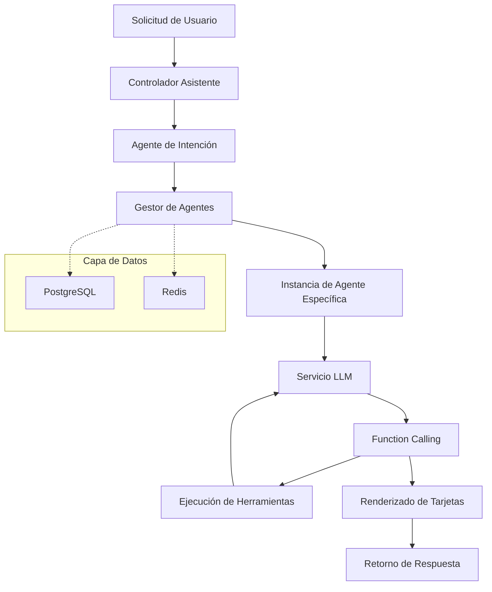

# Plataforma de Arquitectura Multiagente

[](https://www.oracle.com/java/)
[](https://spring.io/projects/spring-boot)
[](https://spring.io/projects/spring-ai)
[](https://opensource.org/licenses/Apache-2.0)
[](https://www.docker.com/)

## 🌍 Selección de Idioma | Language Select

**Español** | [简体中文](README.md) | [English](README_EN.md) | [日本語](README_JA.md) | [한국어](README_KO.md) | [Русский](README_RU.md)

---

> 🚀 Una plataforma de arquitectura multiagente de nivel empresarial basada en Spring AI y WebFlux, que soporta paradigmas avanzados como Function Calling y ReAct, proporcionando una infraestructura potente y flexible para construir sistemas de conversación inteligentes.

## ✨ Características Principales

- 🤖 **Arquitectura de Colaboración Multiagente** - Gestión y programación unificadas de varios tipos de agentes inteligentes
- 🔄 **Soporte Function Calling** - Capacidades completas de llamada de herramientas con extensiones de funciones personalizadas
- ⚡ **Implementación del Paradigma ReAct** - Ciclos de Razonamiento-Acción que permiten razonamientos complejos de múltiples pasos
- 🌊 **Programación Reactiva** - Arquitectura asíncrona no bloqueante basada en WebFlux
- 💾 **Soporte Multi Fuente de Datos** - Estrategia de almacenamiento dual de datos con PostgreSQL + Redis
- 🐳 **Despliegue Contenerizado** - Soporte completo de Docker con despliegue de un solo clic
- 🔧 **Alta Configurabilidad** - Gestión de configuración flexible soportando múltiples proveedores LLM
- 🎯 **Características Empresariales** - Aislamiento de usuarios, gestión de permisos, persistencia de sesiones

## 🏗️ Vista General de la Arquitectura



## 🚀 Inicio Rápido

### Requisitos

- **Java**: 17+
- **Maven**: 3.6+
- **PostgreSQL**: 12+
- **Redis**: 6+

### Configuración del Entorno de Desarrollo Local

1. **Clonar Proyecto**
   ```bash
   git clone https://github.com/your-username/multi-agent-arch.git
   cd multi-agent-arch
   ```

2. **Configurar Base de Datos**

   Crear base de datos PostgreSQL:
   ```sql
   CREATE DATABASE assistant;
   ```

3. **Configurar Variables de Entorno**

   Copiar y editar archivo de configuración:
   ```bash
   # Configuración de base de datos
   export SPRING_DATASOURCE_URL=jdbc:postgresql://localhost:5432/assistant
   export SPRING_DATASOURCE_USERNAME=your_username
   export SPRING_DATASOURCE_PASSWORD=your_password

   # Configuración de Redis
   export SPRING_REDIS_HOST=localhost
   export SPRING_REDIS_PORT=6379
   export SPRING_REDIS_PASSWORD=your_redis_password

   # Configuración de LLM (API compatible con OpenAI)
   export LLM_MODEL_SERIES=qwen
   export LLM_API_KEY=your_api_key
   export LLM_ADDRESS=https://dashscope.aliyuncs.com/compatible-mode/v1
   export LLM_MODEL=qwen-plus
   ```

4. **Ejecutar Aplicación**
   ```bash
   mvn spring-boot:run
   ```

   O construir y ejecutar:
   ```bash
   mvn clean package
   java -jar target/mss-ai.jar
   ```

5. **Verificar Servicio**

   Después del inicio del servicio, visitar el endpoint de verificación de salud:
   ```bash
   curl http://localhost:8080/ai/actuator/health
   ```

### Despliegue Docker

1. **Construir Imagen**
   ```bash
   mvn clean package
   docker build -t multi-agent-arch .
   ```

2. **Ejecutar Contenedor**
   ```bash
   docker run -d \
     --name multi-agent-arch \
     -p 8080:8080 \
     -e SPRING_DATASOURCE_URL=jdbc:postgresql://host.docker.internal:5432/assistant \
     -e SPRING_DATASOURCE_USERNAME=your_username \
     -e SPRING_DATASOURCE_PASSWORD=your_password \
     -e LLM_API_KEY=your_api_key \
     multi-agent-arch
   ```

## 📚 Documentación de la API

### Interfaz de Completado de Chat

**POST** `/ai/chat/completions`

Iniciar conversación con agentes, soportando respuestas streaming.

```bash
curl -X POST http://localhost:8080/ai/chat/completions \
  -H "Content-Type: application/json" \
  -d '{
    "content": "Ayúdame a revisar el clima de hoy",
    "extra": {
      "location": "Beijing",
      "language": "es"
    }
  }'
```

**Parámetros de Solicitud:**
- `content` (string, requerido): Contenido del mensaje de entrada del usuario
- `extra` (object, opcional): Información de contexto adicional

**Formato de Respuesta:**
```json
{
  "content": "OK, déjame ayudarte a revisar la información del clima en Beijing...",
  "status": "REPLYING",
  "data": {},
  "design": {}
}
```

### Reconocimiento de Intenciones

El sistema reconoce automáticamente las intenciones del usuario y despacha agentes correspondientes:

- **Agente de Conversación General** - Maneja conversaciones diarias
- **Agente de Llamada de Herramientas** - Ejecuta llamadas de funciones específicas
- **Agente de Recuperación de Conocimiento** - Realiza consultas y análisis de información

### Soporte Function Calling

El sistema soporta el ciclo de vida completo de llamada de funciones:

1. **Registro de Funciones** - Definir funciones de herramientas disponibles en la configuración del agente
2. **Análisis de Llamada** - LLM identifica automáticamente las funciones a llamar
3. **Extracción de Parámetros** - Extraer parámetros de llamada de funciones de las conversaciones
4. **Ejecución de Funciones** - Llamar la lógica de negocio real
5. **Procesamiento de Resultados** - Alimentar los resultados de ejecución de vuelta al LLM para el siguiente paso de procesamiento

## 🛠️ Componentes Principales

### Gestor de Agentes

Responsable de la gestión del ciclo de vida de los agentes:
- Carga y gestión de tipos de agentes
- Creación y destrucción de instancias de agentes
- Gestión de tiempo de espera de estado de sesión (expiración automática de 15 minutos)

### Agente de Intenciones

Sistema de reconocimiento de intenciones basado en LLM:
- Analizar el tipo de negocio de la entrada del usuario
- Despacho automático a agentes profesionales correspondientes
- Soporte de configuración dinámica de intenciones

### Servicio LLM

Interfaz unificada de llamada LLM:
- Soporte para múltiples proveedores LLM (actualmente implementa 通义千问)
- Modos de respuesta streaming y no-streaming
- Soporte completo de Function Calling

### Servicio de Llamada de Funciones

Framework de llamada de funciones extensible:
- Soporte para llamadas de funciones locales y remotas
- Interfaz de llamada unificada y formato de respuesta
- Soporte de renderizado de respuestas estilo tarjeta

## 🔧 Configuración

### Ejemplo Completo de application.yaml

```yaml
# Configuración básica del servicio
spring:
  webflux:
    base-path: /ai
  data:
    redis:
      host: ${SPRING_REDIS_HOST:localhost}
      port: ${SPRING_REDIS_PORT:6379}
      password: ${SPRING_REDIS_PASSWORD}
  datasource:
    url: ${SPRING_DATASOURCE_URL:jdbc:postgresql://localhost:5432/assistant}
    username: ${SPRING_DATASOURCE_USERNAME}
    password: ${SPRING_DATASOURCE_PASSWORD}
    driver-class-name: org.postgresql.Driver
  jpa:
    hibernate:
      ddl-auto: update
    show-sql: true
    properties:
      hibernate:
        dialect: org.hibernate.dialect.PostgreSQLDialect

# Configuración de negocio
business:
  llm:
    model-series: ${LLM_MODEL_SERIES:qwen}
    api-key: ${LLM_API_KEY}
    url: ${LLM_ADDRESS}
    model: ${LLM_MODEL}

# Configuración de logging
logging:
  level:
    root: ${LOGGING_LEVEL:info}
    site.nullpointer.mss.ai: DEBUG
```

## 🎯 Ejemplos de Uso

### 1. Conversación Básica

```bash
curl -X POST http://localhost:8080/ai/chat/completions \
  -H "Content-Type: application/json" \
  -d '{
    "content": "Hola, por favor preséntate"
  }'
```

### 2. Ejemplo de Function Calling

```bash
curl -X POST http://localhost:8080/ai/chat/completions \
  -H "Content-Type: application/json" \
  -d '{
    "content": "Ayúdame a crear un todo: completar la documentación del proyecto",
    "extra": {
      "priority": "high",
      "category": "work"
    }
  }'
```

### 3. Ejemplo del Paradigma ReAct

```bash
curl -X POST http://localhost:8080/ai/chat/completions \
  -H "Content-Type: application/json" \
  -d '{
    "content": "Necesito analizar datos de comportamiento de compra de usuarios, ¿puedes ayudarme?"
  }'
```

El sistema ejecutará automáticamente los siguientes pasos:
1. Analizar los requisitos del usuario
2. Llamar herramientas de análisis de datos
3. Analizar los resultados del análisis
4. Proporcionar insights y recomendaciones

## 🧪 Guía de Desarrollo

### Añadir Nuevos Tipos de Agentes

1. Insertar nuevo tipo de agente en la base de datos:
```sql
INSERT INTO agent_type (type, system_prompt, function_tools, temperature, description, is_public, enterprise_id)
VALUES (
  'CUSTOM_AGENT',
  'Eres un asistente profesional de análisis de datos...',
  '[{"function": {"name": "analyze_data", "description": "Analizar datos"}}]',
  0.7,
  'Agente de Análisis de Datos',
  true,
  'default'
);
```

2. Reiniciar la aplicación o llamar al método `loadAgentType()` del AgentManager para recargar la configuración.

### Function Calling Personalizado

1. Implementar la interfaz `FunctionCallService`:
```java
@Service
public class CustomFunctionCallService implements FunctionCallService {
    @Override
    public FunctionCallResult apply(FunctionCallRequest request) {
        // Implementar tu lógica de negocio
        return FunctionCallResult.builder()
            .content("Resultado de ejecución")
            .build();
    }
}
```

2. Registrar tu función en la configuración del agente:
```json
{
  "function": {
    "name": "custom_function",
    "description": "Descripción de función personalizada",
    "parameters": {
      "type": "object",
      "properties": {
        "param1": {"type": "string"}
      }
    }
  }
}
```

## 🤝 Contribuir

¡Bienvenimos todas las formas de contribuciones! Por favor lee las siguientes guías:

1. Fork este repositorio
2. Crea tu rama de características (`git checkout -b feature/AmazingFeature`)
3. Commit tus cambios (`git commit -m 'Add some AmazingFeature'`)
4. Push a la rama (`git push origin feature/AmazingFeature`)
5. Abre un Pull Request

### Estándares de Código

- Seguir las mejores prácticas de Spring Boot
- Usar Lombok para reducir código boilerplate
- Mantener el código limpio y legible
- Añadir pruebas unitarias apropiadas

## 📄 Licencia

Este proyecto está licenciado bajo la Licencia Apache 2.0. Ver archivo [LICENSE](LICENSE) para detalles.

## 🙏 Agradecimientos

- [Spring AI](https://spring.io/projects/spring-ai) - Proporcionando un potente framework de integración AI
- [Spring WebFlux](https://spring.io/projects/spring-boot) - Framework web reactivo
- [通义千问](https://qianwen.aliyun.com/) - Proporcionando excelentes capacidades LLM

## 📞 Contacto

- Página principal del proyecto: [https://github.com/your-username/multi-agent-arch](https://github.com/your-username/multi-agent-arch)
- Retroalimentación de problemas: [Issues](https://github.com/your-username/multi-agent-arch/issues)
- Discusiones: [Discussions](https://github.com/your-username/multi-agent-arch/discussions)

---

<div align="center">
  <p>Si este proyecto te ayuda, por favor danos una ⭐️</p>
  <p>Made with ❤️ by the Multi-Agent Architecture Team</p>
</div>