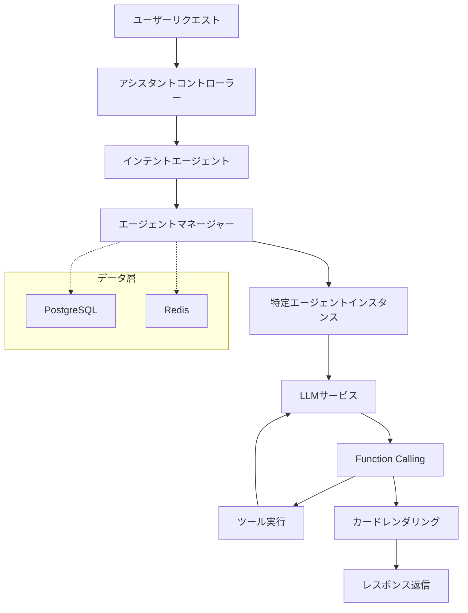

# マルチエージェントアーキテクチャプラットフォーム

[](https://www.oracle.com/java/)
[](https://spring.io/projects/spring-boot)
[](https://spring.io/projects/spring-ai)
[](https://opensource.org/licenses/Apache-2.0)
[](https://www.docker.com/)

## 🌍 言語選択 | Language Select

**日本語** | [简体中文](README.md) | [English](README_EN.md) | [한국어](README_KO.md) | [Русский](README_RU.md) | [Español](README_ES.md)

---

> 🚀 Spring AIとWebFluxに基づくエンタープライズグレードのマルチエージェントアーキテクチャプラットフォーム。Function Calling、ReActなどの先進的なパラダイムをサポートし、インテリジェントな対話システム構築のための強力で柔軟なインフラを提供します。

## ✨ コア機能

- 🤖 **マルチエージェント連携アーキテクチャ** - 多様なタイプのインテリジェントエージェントの統一管理とスケジューリング
- 🔄 **Function Callingサポート** - カスタム関数拡張を備えた完全なツール呼び出し機能
- ⚡ **ReActパラダイム実装** - 複雑な多段階推論を可能にする推論-行動サイクル
- 🌊 **リアクティブプログラミング** - WebFluxに基づくノンブロッキング非同期アーキテクチャ
- 💾 **マルチデータソースサポート** - PostgreSQL + Redisのデュアルデータストレージ戦略
- 🐳 **コンテナ化デプロイメント** - 完全なDockerサポートとワンクリックデプロイメント
- 🔧 **高設定可能性** - 複数のLLMプロバイダをサポートする柔軟な設定管理
- 🎯 **エンタープライズ機能** - ユーザー分離、権限管理、セッション永続化

## 🏗️ アーキテクチャ概要



## 🚀 クイックスタート

### 要件

- **Java**: 17+
- **Maven**: 3.6+
- **PostgreSQL**: 12+
- **Redis**: 6+

### ローカル開発環境セットアップ

1. **プロジェクトのクローン**
   ```bash
   git clone https://github.com/your-username/multi-agent-arch.git
   cd multi-agent-arch
   ```

2. **データベース設定**

   PostgreSQLデータベースを作成：
   ```sql
   CREATE DATABASE assistant;
   ```

3. **環境変数設定**

   設定ファイルをコピーして編集：
   ```bash
   # データベース設定
   export SPRING_DATASOURCE_URL=jdbc:postgresql://localhost:5432/assistant
   export SPRING_DATASOURCE_USERNAME=your_username
   export SPRING_DATASOURCE_PASSWORD=your_password

   # Redis設定
   export SPRING_REDIS_HOST=localhost
   export SPRING_REDIS_PORT=6379
   export SPRING_REDIS_PASSWORD=your_redis_password

   # LLM設定（OpenAI互換API）
   export LLM_MODEL_SERIES=qwen
   export LLM_API_KEY=your_api_key
   export LLM_ADDRESS=https://dashscope.aliyuncs.com/compatible-mode/v1
   export LLM_MODEL=qwen-plus
   ```

4. **アプリケーション実行**
   ```bash
   mvn spring-boot:run
   ```

   またはビルドして実行：
   ```bash
   mvn clean package
   java -jar target/mss-ai.jar
   ```

5. **サービス検証**

   サービス起動後、ヘルスチェックエンドポイントにアクセス：
   ```bash
   curl http://localhost:8080/ai/actuator/health
   ```

### Dockerデプロイメント

1. **イメージ構築**
   ```bash
   mvn clean package
   docker build -t multi-agent-arch .
   ```

2. **コンテナ実行**
   ```bash
   docker run -d \
     --name multi-agent-arch \
     -p 8080:8080 \
     -e SPRING_DATASOURCE_URL=jdbc:postgresql://host.docker.internal:5432/assistant \
     -e SPRING_DATASOURCE_USERNAME=your_username \
     -e SPRING_DATASOURCE_PASSWORD=your_password \
     -e LLM_API_KEY=your_api_key \
     multi-agent-arch
   ```

## 📚 APIドキュメント

### チャット補完インターフェース

**POST** `/ai/chat/completions`

エージェントとの対話を開始し、ストリーミングレスポンスをサポート。

```bash
curl -X POST http://localhost:8080/ai/chat/completions \
  -H "Content-Type: application/json" \
  -d '{
    "content": "今日の天気を確認してください",
    "extra": {
      "location": "北京",
      "language": "ja"
    }
  }'
```

**リクエストパラメータ:**
- `content` (string, 必須): ユーザー入力メッセージ内容
- `extra` (object, オプション): 追加のコンテキスト情報

**レスポンス形式:**
```json
{
  "content": "はい、北京の天気情報をお調べします...",
  "status": "REPLYING",
  "data": {},
  "design": {}
}
```

### インテント認識

システムはユーザーのインテントを自動的に認識し、対応するエージェントをディスパッチします：

- **一般会話エージェント** - 日常的な会話を処理
- **ツール呼び出しエージェント** - 特定の関数呼び出しを実行
- **知識検索エージェント** - 情報クエリと分析を実行

### Function Callingサポート

システムは完全な関数呼び出しライフサイクルをサポート：

1. **関数登録** - エージェント設定で利用可能なツール関数を定義
2. **呼び出し解析** - LLMが呼び出す関数を自動的に認識
3. **パラメータ抽出** - 会話から関数呼び出しパラメータを抽出
4. **関数実行** - 実際のビジネスロジックを呼び出し
5. **結果処理** - 実行結果をLLMにフィードバックし、次のステップ処理を実行

## 🛠️ コアコンポーネント

### エージェントマネージャー

エージェントライフサイクル管理を担当：
- エージェントタイプの読み込みと管理
- エージェントインスタンスの作成と破棄
- セッション状態のタイムアウト管理（15分自動有効期限切れ）

### インテントエージェント

LLMベースのインテント認識システム：
- ユーザー入力のビジネスタイプを分析
- 対応する専門エージェントへの自動ディスパッチ
- 動的インテント設定をサポート

### LLMサービス

統一されたLLM呼び出しインターフェース：
- 複数のLLMプロバイダをサポート（現在は通義千問を実装）
- ストリーミングと非ストリーミングレスポンスモード
- 完全なFunction Callingサポート

### Function Callサービス

拡張可能な関数呼び出しフレームワーク：
- ローカルとリモートの関数呼び出しをサポート
- 統一された呼び出しインターフェースとレスポンス形式
- カードスタイルレスポンスレンダリングをサポート

## 🔧 設定

### 完全なapplication.yaml例

```yaml
# 基本サービス設定
spring:
  webflux:
    base-path: /ai
  data:
    redis:
      host: ${SPRING_REDIS_HOST:localhost}
      port: ${SPRING_REDIS_PORT:6379}
      password: ${SPRING_REDIS_PASSWORD}
  datasource:
    url: ${SPRING_DATASOURCE_URL:jdbc:postgresql://localhost:5432/assistant}
    username: ${SPRING_DATASOURCE_USERNAME}
    password: ${SPRING_DATASOURCE_PASSWORD}
    driver-class-name: org.postgresql.Driver
  jpa:
    hibernate:
      ddl-auto: update
    show-sql: true
    properties:
      hibernate:
        dialect: org.hibernate.dialect.PostgreSQLDialect

# ビジネス設定
business:
  llm:
    model-series: ${LLM_MODEL_SERIES:qwen}
    api-key: ${LLM_API_KEY}
    url: ${LLM_ADDRESS}
    model: ${LLM_MODEL}

# ログ設定
logging:
  level:
    root: ${LOGGING_LEVEL:info}
    site.nullpointer.mss.ai: DEBUG
```

## 🎯 使用例

### 1. 基本会話

```bash
curl -X POST http://localhost:8080/ai/chat/completions \
  -H "Content-Type: application/json" \
  -d '{
    "content": "こんにちは、自己紹介してください"
  }'
```

### 2. Function Calling例

```bash
curl -X POST http://localhost:8080/ai/chat/completions \
  -H "Content-Type: application/json" \
  -d '{
    "content": "プロジェクトドキュメントの作成を手伝ってください",
    "extra": {
      "priority": "high",
      "category": "work"
    }
  }'
```

### 3. ReActパラダイム例

```bash
curl -X POST http://localhost:8080/ai/chat/completions \
  -H "Content-Type: application/json" \
  -d '{
    "content": "ユーザーの購買行動データを分析する必要があります、手伝ってもらえますか？"
  }'
```

システムは自動的に以下のステップを実行します：
1. ユーザー要件を分析
2. データ分析ツールを呼び出し
3. 分析結果を解析
4. 洞察と推奨事項を提供

## 🧪 開発ガイド

### 新しいエージェントタイプの追加

1. データベースに新しいエージェントタイプを挿入：
```sql
INSERT INTO agent_type (type, system_prompt, function_tools, temperature, description, is_public, enterprise_id)
VALUES (
  'CUSTOM_AGENT',
  'あなたは専門のデータ分析アシスタントです...',
  '[{"function": {"name": "analyze_data", "description": "データを分析"}}]',
  0.7,
  'データ分析エージェント',
  true,
  'default'
);
```

2. アプリケーションを再起動するか、AgentManagerの`loadAgentType()`メソッドを呼び出して設定を再読み込み。

### カスタムFunction Calling

1. `FunctionCallService`インターフェースを実装：
```java
@Service
public class CustomFunctionCallService implements FunctionCallService {
    @Override
    public FunctionCallResult apply(FunctionCallRequest request) {
        // ビジネスロジックを実装
        return FunctionCallResult.builder()
            .content("実行結果")
            .build();
    }
}
```

2. エージェント設定に関数を登録：
```json
{
  "function": {
    "name": "custom_function",
    "description": "カスタム関数説明",
    "parameters": {
      "type": "object",
      "properties": {
        "param1": {"type": "string"}
      }
    }
  }
}
```

## 🤝 貢献

あらゆる形式の貢献を歓迎します！以下のガイドラインをお読みください：

1. このリポジトリをフォーク
2. 機能ブランチを作成 (`git checkout -b feature/AmazingFeature`)
3. 変更をコミット (`git commit -m 'Add some AmazingFeature'`)
4. ブランチにプッシュ (`git push origin feature/AmazingFeature`)
5. プルリクエストを開く

### コード標準

- Spring Bootベストプラクティスに従う
- Lombokを使用してボイラープレートコードを削減
- コードをクリーンで読みやすく保つ
- 適切な単体テストを追加

## 📄 ライセンス

このプロジェクトはApache License 2.0の下でライセンスされています。詳細は[LICENSE](LICENSE)ファイルを参照してください。

## 🙏 謝辞

- [Spring AI](https://spring.io/projects/spring-ai) - 強力なAI統合フレームワークを提供
- [Spring WebFlux](https://spring.io/projects/spring-boot) - リアクティブWebフレームワーク
- [通義千問](https://qianwen.aliyun.com/) - 優れたLLM機能を提供

## 📞 お問い合わせ

- プロジェクトホームページ: [https://github.com/your-username/multi-agent-arch](https://github.com/your-username/multi-agent-arch)
- 問題フィードバック: [Issues](https://github.com/your-username/multi-agent-arch/issues)
- 議論: [Discussions](https://github.com/your-username/multi-agent-arch/discussions)

---

<div align="center">
  <p>このプロジェクトがお役に立てたら、⭐️をください</p>
  <p>Made with ❤️ by the Multi-Agent Architecture Team</p>
</div>