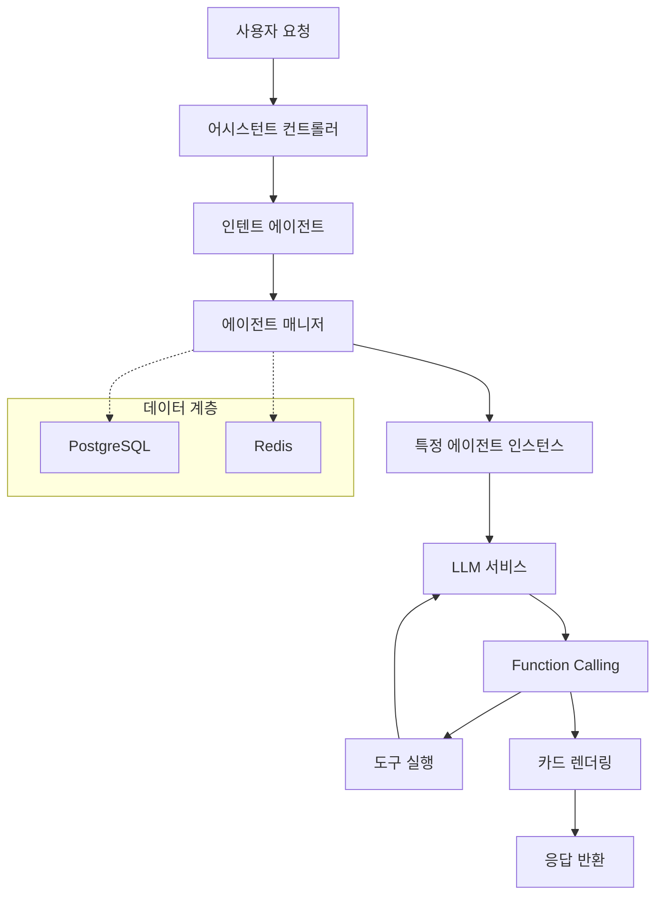

# 멀티 에이전트 아키텍처 플랫폼

[](https://www.oracle.com/java/)
[](https://spring.io/projects/spring-boot)
[](https://spring.io/projects/spring-ai)
[](https://opensource.org/licenses/Apache-2.0)
[](https://www.docker.com/)

## 🌍 언어 선택 | Language Select

**한국어** | [简体中文](README.md) | [English](README_EN.md) | [日本語](README_JA.md) | [Русский](README_RU.md) | [Español](README_ES.md)

---

> 🚀 Spring AI와 WebFlux 기반의 엔터프라이즈급 멀티 에이전트 아키텍처 플랫폼. Function Calling, ReAct 등 첨단 패러다임을 지원하여 지능형 대화 시스템 구축을 위한 강력하고 유연한 인프라를 제공합니다.

## ✨ 핵심 기능

- 🤖 **멀티 에이전트 협업 아키텍처** - 다양한 유형의 지능형 에이전트 통합 관리 및 스케줄링
- 🔄 **Function Calling 지원** - 커스텀 함수 확장을 포함한 완전한 도구 호출 기능
- ⚡ **ReAct 패러다임 구현** - 복잡한 다단계 추론을 가능하게 하는 추론-행동 사이클
- 🌊 **리액티브 프로그래밍** - WebFlux 기반의 논블로킹 비동기 아키텍처
- 💾 **멀티 데이터소스 지원** - PostgreSQL + Redis 이중 데이터 저장소 전략
- 🐳 **컨테이너화 배포** - 완전한 Docker 지원과 원클릭 배포
- 🔧 **고도 설정 가능성** - 여러 LLM 공급자를 지원하는 유연한 설정 관리
- 🎯 **엔터프라이즈 기능** - 사용자 분리, 권한 관리, 세션 지속성

## 🏗️ 아키텍처 개요



## 🚀 빠른 시작

### 요구사항

- **Java**: 17+
- **Maven**: 3.6+
- **PostgreSQL**: 12+
- **Redis**: 6+

### 로컬 개발 환경 설정

1. **프로젝트 클론**
   ```bash
   git clone https://github.com/your-username/multi-agent-arch.git
   cd multi-agent-arch
   ```

2. **데이터베이스 설정**

   PostgreSQL 데이터베이스 생성:
   ```sql
   CREATE DATABASE assistant;
   ```

3. **환경 변수 설정**

   설정 파일 복사 및 편집:
   ```bash
   # 데이터베이스 설정
   export SPRING_DATASOURCE_URL=jdbc:postgresql://localhost:5432/assistant
   export SPRING_DATASOURCE_USERNAME=your_username
   export SPRING_DATASOURCE_PASSWORD=your_password

   # Redis 설정
   export SPRING_REDIS_HOST=localhost
   export SPRING_REDIS_PORT=6379
   export SPRING_REDIS_PASSWORD=your_redis_password

   # LLM 설정 (OpenAI 호환 API)
   export LLM_MODEL_SERIES=qwen
   export LLM_API_KEY=your_api_key
   export LLM_ADDRESS=https://dashscope.aliyuncs.com/compatible-mode/v1
   export LLM_MODEL=qwen-plus
   ```

4. **애플리케이션 실행**
   ```bash
   mvn spring-boot:run
   ```

   또는 빌드 후 실행:
   ```bash
   mvn clean package
   java -jar target/mss-ai.jar
   ```

5. **서비스 검증**

   서비스 시작 후 헬스체크 엔드포인트 접속:
   ```bash
   curl http://localhost:8080/ai/actuator/health
   ```

### Docker 배포

1. **이미지 빌드**
   ```bash
   mvn clean package
   docker build -t multi-agent-arch .
   ```

2. **컨테이너 실행**
   ```bash
   docker run -d \
     --name multi-agent-arch \
     -p 8080:8080 \
     -e SPRING_DATASOURCE_URL=jdbc:postgresql://host.docker.internal:5432/assistant \
     -e SPRING_DATASOURCE_USERNAME=your_username \
     -e SPRING_DATASOURCE_PASSWORD=your_password \
     -e LLM_API_KEY=your_api_key \
     multi-agent-arch
   ```

## 📚 API 문서

### 채팅 완료 인터페이스

**POST** `/ai/chat/completions`

에이전트와의 대화를 시작하고 스트리밍 응답을 지원합니다.

```bash
curl -X POST http://localhost:8080/ai/chat/completions \
  -H "Content-Type: application/json" \
  -d '{
    "content": "오늘 날씨를 확인해주세요",
    "extra": {
      "location": "베이징",
      "language": "ko"
    }
  }'
```

**요청 파라미터:**
- `content` (string, 필수): 사용자 입력 메시지 내용
- `extra` (object, 선택적): 추가 컨텍스트 정보

**응답 형식:**
```json
{
  "content": "네, 베이징의 날씨 정보를 확인해드리겠습니다...",
  "status": "REPLYING",
  "data": {},
  "design": {}
}
```

### 인텐트 인식

시스템은 사용자 인텐트를 자동으로 인식하고 해당 에이전트를 디스패치합니다:

- **일반 대화 에이전트** - 일상 대화 처리
- **도구 호출 에이전트** - 특정 함수 호출 실행
- **지식 검색 에이전트** - 정보 쿼리 및 분석 수행

### Function Calling 지원

시스템은 완전한 함수 호출 라이프사이클을 지원합니다:

1. **함수 등록** - 에이전트 설정에서 사용 가능한 도구 함수 정의
2. **호출 파싱** - LLM이 호출할 함수를 자동으로 식별
3. **파라미터 추출** - 대화에서 함수 호출 파라미터 추출
4. **함수 실행** - 실제 비즈니스 로직 호출
5. **결과 처리** - 실행 결과를 LLM에 피드백하여 다음 단계 처리

## 🛠️ 핵심 컴포넌트

### 에이전트 매니저

에이전트 라이프사이클 관리를 담당:
- 에이전트 타입 로딩 및 관리
- 에이전트 인스턴스 생성 및 소멸
- 세션 상태 타임아웃 관리 (15분 자동 만료)

### 인텐트 에이전트

LLM 기반 인텐트 인식 시스템:
- 사용자 입력의 비즈니스 타입 분석
- 해당 전문 에이전트로 자동 디스패치
- 동적 인텐트 설정 지원

### LLM 서비스

통합된 LLM 호출 인터페이스:
- 여러 LLM 공급자 지원 (현재 通义千问 구현)
- 스트리밍 및 비스트리밍 응답 모드
- 완전한 Function Calling 지원

### Function Call 서비스

확장 가능한 함수 호출 프레임워크:
- 로컬 및 원격 함수 호출 지원
- 통합된 호출 인터페이스 및 응답 형식
- 카드 스타일 응답 렌더링 지원

## 🔧 설정

### 완전한 application.yaml 예제

```yaml
# 기본 서비스 설정
spring:
  webflux:
    base-path: /ai
  data:
    redis:
      host: ${SPRING_REDIS_HOST:localhost}
      port: ${SPRING_REDIS_PORT:6379}
      password: ${SPRING_REDIS_PASSWORD}
  datasource:
    url: ${SPRING_DATASOURCE_URL:jdbc:postgresql://localhost:5432/assistant}
    username: ${SPRING_DATASOURCE_USERNAME}
    password: ${SPRING_DATASOURCE_PASSWORD}
    driver-class-name: org.postgresql.Driver
  jpa:
    hibernate:
      ddl-auto: update
    show-sql: true
    properties:
      hibernate:
        dialect: org.hibernate.dialect.PostgreSQLDialect

# 비즈니스 설정
business:
  llm:
    model-series: ${LLM_MODEL_SERIES:qwen}
    api-key: ${LLM_API_KEY}
    url: ${LLM_ADDRESS}
    model: ${LLM_MODEL}

# 로깅 설정
logging:
  level:
    root: ${LOGGING_LEVEL:info}
    site.nullpointer.mss.ai: DEBUG
```

## 🎯 사용 예제

### 1. 기본 대화

```bash
curl -X POST http://localhost:8080/ai/chat/completions \
  -H "Content-Type: application/json" \
  -d '{
    "content": "안녕하세요, 자기소개를 해주세요"
  }'
```

### 2. Function Calling 예제

```bash
curl -X POST http://localhost:8080/ai/chat/completions \
  -H "Content-Type: application/json" \
  -d '{
    "content": "프로젝트 문서 작성을 도와주세요",
    "extra": {
      "priority": "high",
      "category": "work"
    }
  }'
```

### 3. ReAct 패러다임 예제

```bash
curl -X POST http://localhost:8080/ai/chat/completions \
  -H "Content-Type: application/json" \
  -d '{
    "content": "사용자 구매 행동 데이터를 분석해야 합니다. 도와주시겠어요?"
  }'
```

시스템은 자동으로 다음 단계를 실행합니다:
1. 사용자 요구사항 분석
2. 데이터 분석 도구 호출
3. 분석 결과 파싱
4. 인사이트 및 권장사항 제공

## 🧪 개발 가이드

### 새로운 에이전트 타입 추가

1. 데이터베이스에 새로운 에이전트 타입 삽입:
```sql
INSERT INTO agent_type (type, system_prompt, function_tools, temperature, description, is_public, enterprise_id)
VALUES (
  'CUSTOM_AGENT',
  '당신은 전문 데이터 분석 어시스턴트입니다...',
  '[{"function": {"name": "analyze_data", "description": "데이터 분석"}}]',
  0.7,
  '데이터 분석 에이전트',
  true,
  'default'
);
```

2. 애플리케이션을 재시작하거나 AgentManager의 `loadAgentType()` 메서드를 호출하여 설정을 다시 로드합니다.

### 커스텀 Function Calling

1. `FunctionCallService` 인터페이스 구현:
```java
@Service
public class CustomFunctionCallService implements FunctionCallService {
    @Override
    public FunctionCallResult apply(FunctionCallRequest request) {
        // 비즈니스 로직 구현
        return FunctionCallResult.builder()
            .content("실행 결과")
            .build();
    }
}
```

2. 에이전트 설정에 함수 등록:
```json
{
  "function": {
    "name": "custom_function",
    "description": "커스텀 함수 설명",
    "parameters": {
      "type": "object",
      "properties": {
        "param1": {"type": "string"}
      }
    }
  }
}
```

## 🤝 기여

모든 형태의 기여를 환영합니다! 다음 가이드라인을 읽어보세요:

1. 이 저장소를 포크
2. 기능 브랜치 생성 (`git checkout -b feature/AmazingFeature`)
3. 변경사항 커밋 (`git commit -m 'Add some AmazingFeature'`)
4. 브랜치에 푸시 (`git push origin feature/AmazingFeature`)
5. 풀 리퀘스트 열기

### 코드 표준

- Spring Boot 베스트 프랙티스 따르기
- Lombok을 사용하여 상용구 코드 감소
- 코드를 깨끗하고 읽기 쉽게 유지
- 적절한 단위 테스트 추가

## 📄 라이선스

이 프로젝트는 Apache License 2.0 하에 라이선스가 부여됩니다. 자세한 내용은 [LICENSE](LICENSE) 파일을 참조하세요.

## 🙏 감사 인사

- [Spring AI](https://spring.io/projects/spring-ai) - 강력한 AI 통합 프레임워크 제공
- [Spring WebFlux](https://spring.io/projects/spring-boot) - 리액티브 웹 프레임워크
- [通义千问](https://qianwen.aliyun.com/) - 훌륭한 LLM 기능 제공

## 📞 연락처

- 프로젝트 홈페이지: [https://github.com/your-username/multi-agent-arch](https://github.com/your-username/multi-agent-arch)
- 문제 피드백: [Issues](https://github.com/your-username/multi-agent-arch/issues)
- 토론: [Discussions](https://github.com/your-username/multi-agent-arch/discussions)

---

<div align="center">
  <p>이 프로젝트가 도움이 되었다면 ⭐️를 주세요</p>
  <p>Made with ❤️ by the Multi-Agent Architecture Team</p>
</div>