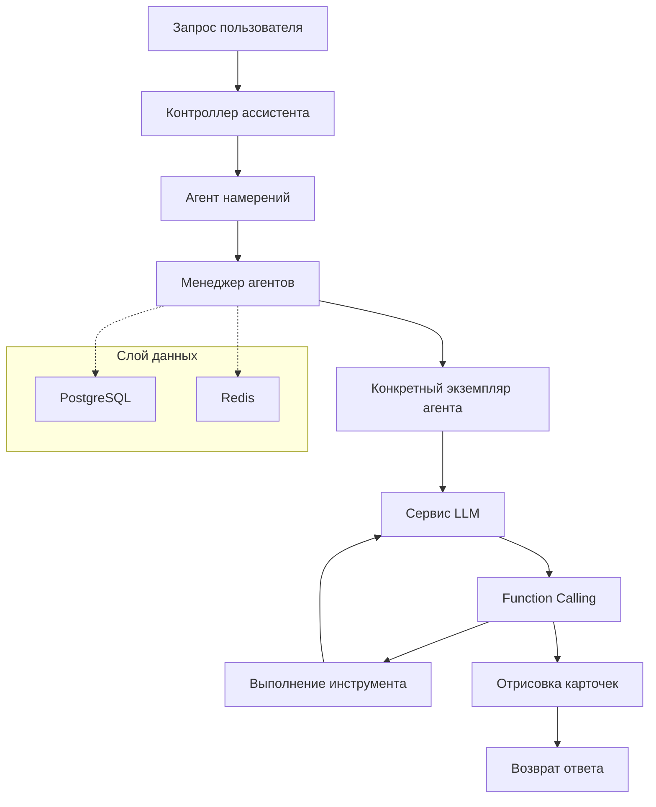

# Платформа мультиагентной архитектуры

[](https://www.oracle.com/java/)
[](https://spring.io/projects/spring-boot)
[](https://spring.io/projects/spring-ai)
[](https://opensource.org/licenses/Apache-2.0)
[](https://www.docker.com/)

## 🌍 Выбор языка | Language Select

**Русский** | [简体中文](README.md) | [English](README_EN.md) | [日本語](README_JA.md) | [한국어](README_KO.md) | [Español](README_ES.md)

---

> 🚀 Предприятийская платформа мультиагентной архитектуры на основе Spring AI и WebFlux, поддерживающая передовые парадигмы, такие как Function Calling и ReAct, предоставляющая мощную и гибкую инфраструктуру для создания интеллектуальных диалоговых систем.

## ✨ Основные возможности

- 🤖 **Архитектура мультиагентного сотрудничества** - Унифицированное управление и планирование различных типов интеллектуальных агентов
- 🔄 **Поддержка Function Calling** - Полные возможности вызова инструментов с расширением пользовательских функций
- ⚡ **Реализация парадигмы ReAct** - Циклы рассуждения-действия, позволяющие выполнять сложные многоэтапные рассуждения
- 🌊 **Реактивное программирование** - Неблокирующая асинхронная архитектура на основе WebFlux
- 💾 **Поддержка нескольких источников данных** - Стратегия двойного хранения данных с PostgreSQL + Redis
- 🐳 **Контейнеризированное развертывание** - Полная поддержка Docker с развертыванием в один клик
- 🔧 **Высокая настраиваемость** - Гибкое управление конфигурацией с поддержкой нескольких провайдеров LLM
- 🎯 **Предприятийские возможности** - Изоляция пользователей, управление правами доступа, сохранение сессий

## 🏗️ Обзор архитектуры



## 🚀 Быстрый старт

### Требования

- **Java**: 17+
- **Maven**: 3.6+
- **PostgreSQL**: 12+
- **Redis**: 6+

### Настройка локальной среды разработки

1. **Клонирование проекта**
   ```bash
   git clone https://github.com/your-username/multi-agent-arch.git
   cd multi-agent-arch
   ```

2. **Настройка базы данных**

   Создание базы данных PostgreSQL:
   ```sql
   CREATE DATABASE assistant;
   ```

3. **Настройка переменных окружения**

   Копирование и редактирование файла конфигурации:
   ```bash
   # Конфигурация базы данных
   export SPRING_DATASOURCE_URL=jdbc:postgresql://localhost:5432/assistant
   export SPRING_DATASOURCE_USERNAME=your_username
   export SPRING_DATASOURCE_PASSWORD=your_password

   # Конфигурация Redis
   export SPRING_REDIS_HOST=localhost
   export SPRING_REDIS_PORT=6379
   export SPRING_REDIS_PASSWORD=your_redis_password

   # Конфигурация LLM (API, совместимый с OpenAI)
   export LLM_MODEL_SERIES=qwen
   export LLM_API_KEY=your_api_key
   export LLM_ADDRESS=https://dashscope.aliyuncs.com/compatible-mode/v1
   export LLM_MODEL=qwen-plus
   ```

4. **Запуск приложения**
   ```bash
   mvn spring-boot:run
   ```

   Или сборка и запуск:
   ```bash
   mvn clean package
   java -jar target/mss-ai.jar
   ```

5. **Проверка сервиса**

   После запуска сервиса, посетите конечную точку проверки работоспособности:
   ```bash
   curl http://localhost:8080/ai/actuator/health
   ```

### Развертывание Docker

1. **Сборка образа**
   ```bash
   mvn clean package
   docker build -t multi-agent-arch .
   ```

2. **Запуск контейнера**
   ```bash
   docker run -d \
     --name multi-agent-arch \
     -p 8080:8080 \
     -e SPRING_DATASOURCE_URL=jdbc:postgresql://host.docker.internal:5432/assistant \
     -e SPRING_DATASOURCE_USERNAME=your_username \
     -e SPRING_DATASOURCE_PASSWORD=your_password \
     -e LLM_API_KEY=your_api_key \
     multi-agent-arch
   ```

## 📚 Документация API

### Интерфейс завершения чата

**POST** `/ai/chat/completions`

Начать диалог с агентами, поддерживающими потоковые ответы.

```bash
curl -X POST http://localhost:8080/ai/chat/completions \
  -H "Content-Type: application/json" \
  -d '{
    "content": "Помогите мне проверить сегодняшнюю погоду",
    "extra": {
      "location": "Пекин",
      "language": "ru"
    }
  }'
```

**Параметры запроса:**
- `content` (string, обязательно): Содержимое сообщения ввода пользователя
- `extra` (object, опционально): Дополнительная контекстная информация

**Формат ответа:**
```json
{
  "content": "Хорошо, я помогу вам проверить информацию о погоде в Пекине...",
  "status": "REPLYING",
  "data": {},
  "design": {}
}
```

### Распознавание намерений

Система автоматически распознает намерения пользователей и отправляет соответствующих агентов:

- **Агент общего диалога** - Обрабатывает повседневные разговоры
- **Агент вызова инструментов** - Выполняет конкретные вызовы функций
- **Агент поиска знаний** - Выполняет запросы и анализ информации

### Поддержка Function Calling

Система поддерживает полный жизненный цикл вызова функций:

1. **Регистрация функции** - Определение доступных функций инструментов в конфигурации агента
2. **Разбор вызова** - LLM автоматически определяет вызываемые функции
3. **Извлечение параметров** - Извлечение параметров вызова функций из диалогов
4. **Выполнение функции** - Вызов фактической бизнес-логики
5. **Обработка результатов** - Отправка результатов выполнения обратно в LLM для следующей обработки

## 🛠️ Основные компоненты

### Менеджер агентов

Отвечает за управление жизненным циклом агентов:
- Загрузка и управление типами агентов
- Создание и уничтожение экземпляров агентов
- Управление тайм-аутом состояния сессии (автоматическое истечение через 15 минут)

### Агент намерений

Система распознавания намерений на основе LLM:
- Анализ бизнес-типа ввода пользователя
- Автоматическая отправка соответствующим профессиональным агентам
- Поддержка динамической конфигурации намерений

### Сервис LLM

Унифицированный интерфейс вызова LLM:
- Поддержка нескольких провайдеров LLM (в настоящее время реализован 通义千问)
- Потоковые и непотоковые режимы ответов
- Полная поддержка Function Calling

### Сервис вызова функций

Расширяемый фреймворк вызова функций:
- Поддержка локальных и удаленных вызовов функций
- Унифицированный интерфейс вызова и формат ответов
- Поддержка отрисовки ответов в стиле карточек

## 🔧 Конфигурация

### Полный пример application.yaml

```yaml
# Базовая конфигурация сервиса
spring:
  webflux:
    base-path: /ai
  data:
    redis:
      host: ${SPRING_REDIS_HOST:localhost}
      port: ${SPRING_REDIS_PORT:6379}
      password: ${SPRING_REDIS_PASSWORD}
  datasource:
    url: ${SPRING_DATASOURCE_URL:jdbc:postgresql://localhost:5432/assistant}
    username: ${SPRING_DATASOURCE_USERNAME}
    password: ${SPRING_DATASOURCE_PASSWORD}
    driver-class-name: org.postgresql.Driver
  jpa:
    hibernate:
      ddl-auto: update
    show-sql: true
    properties:
      hibernate:
        dialect: org.hibernate.dialect.PostgreSQLDialect

# Бизнес-конфигурация
business:
  llm:
    model-series: ${LLM_MODEL_SERIES:qwen}
    api-key: ${LLM_API_KEY}
    url: ${LLM_ADDRESS}
    model: ${LLM_MODEL}

# Конфигурация логирования
logging:
  level:
    root: ${LOGGING_LEVEL:info}
    site.nullpointer.mss.ai: DEBUG
```

## 🎯 Примеры использования

### 1. Базовый диалог

```bash
curl -X POST http://localhost:8080/ai/chat/completions \
  -H "Content-Type: application/json" \
  -d '{
    "content": "Здравствуйте, представьтесь, пожалуйста"
  }'
```

### 2. Пример Function Calling

```bash
curl -X POST http://localhost:8080/ai/chat/completions \
  -H "Content-Type: application/json" \
  -d '{
    "content": "Помогите мне создать задачу: завершить документацию проекта",
    "extra": {
      "priority": "high",
      "category": "work"
    }
  }'
```

### 3. Пример парадигмы ReAct

```bash
curl -X POST http://localhost:8080/ai/chat/completions \
  -H "Content-Type: application/json" \
  -d '{
    "content": "Мне нужно проанализировать данные о поведении пользователей при покупках, можете помочь?"
  }'
```

Система автоматически выполнит следующие шаги:
1. Анализ требований пользователя
2. Вызов инструментов анализа данных
3. Разбор результатов анализа
4. Предоставление инсайтов и рекомендаций

## 🧪 Руководство по разработке

### Добавление новых типов агентов

1. Вставить новый тип агента в базу данных:
```sql
INSERT INTO agent_type (type, system_prompt, function_tools, temperature, description, is_public, enterprise_id)
VALUES (
  'CUSTOM_AGENT',
  'Вы профессиональный помощник по анализу данных...',
  '[{"function": {"name": "analyze_data", "description": "Анализ данных"}}]',
  0.7,
  'Агент анализа данных',
  true,
  'default'
);
```

2. Перезапустить приложение или вызвать метод `loadAgentType()` AgentManager для перезагрузки конфигурации.

### Пользовательский Function Calling

1. Реализовать интерфейс `FunctionCallService`:
```java
@Service
public class CustomFunctionCallService implements FunctionCallService {
    @Override
    public FunctionCallResult apply(FunctionCallRequest request) {
        // Реализация вашей бизнес-логики
        return FunctionCallResult.builder()
            .content("Результат выполнения")
            .build();
    }
}
```

2. Зарегистрировать вашу функцию в конфигурации агента:
```json
{
  "function": {
    "name": "custom_function",
    "description": "Описание пользовательской функции",
    "parameters": {
      "type": "object",
      "properties": {
        "param1": {"type": "string"}
      }
    }
  }
}
```

## 🤝 Вклады

Мы приветствуем все формы вкладов! Пожалуйста, прочтите следующие рекомендации:

1. Форкните этот репозиторий
2. Создайте вашу ветку функций (`git checkout -b feature/AmazingFeature`)
3. Зафиксируйте ваши изменения (`git commit -m 'Add some AmazingFeature'`)
4. Отправьте в ветку (`git push origin feature/AmazingFeature`)
5. Откройте Pull Request

### Стандарты кода

- Следуйте лучшим практикам Spring Boot
- Используйте Lombok для сокращения шаблонного кода
- Держите код чистым и читаемым
- Добавляйте соответствующие модульные тесты

## 📄 Лицензия

Этот проект лицензирован под лицензией Apache License 2.0. Подробности в файле [LICENSE](LICENSE).

## 🙏 Благодарности

- [Spring AI](https://spring.io/projects/spring-ai) - Предоставление мощного фреймворка интеграции AI
- [Spring WebFlux](https://spring.io/projects/spring-boot) - Реактивный веб-фреймворк
- [通义千问](https://qianwen.aliyun.com/) - Предоставление отличных возможностей LLM

## 📞 Контакты

- Домашняя страница проекта: [https://github.com/your-username/multi-agent-arch](https://github.com/your-username/multi-agent-arch)
- Обратная связь по проблемам: [Issues](https://github.com/your-username/multi-agent-arch/issues)
- Обсуждения: [Discussions](https://github.com/your-username/multi-agent-arch/discussions)

---

<div align="center">
  <p>Если этот проект помог вам, пожалуйста, дайте нам ⭐️</p>
  <p>Made with ❤️ by the Multi-Agent Architecture Team</p>
</div>